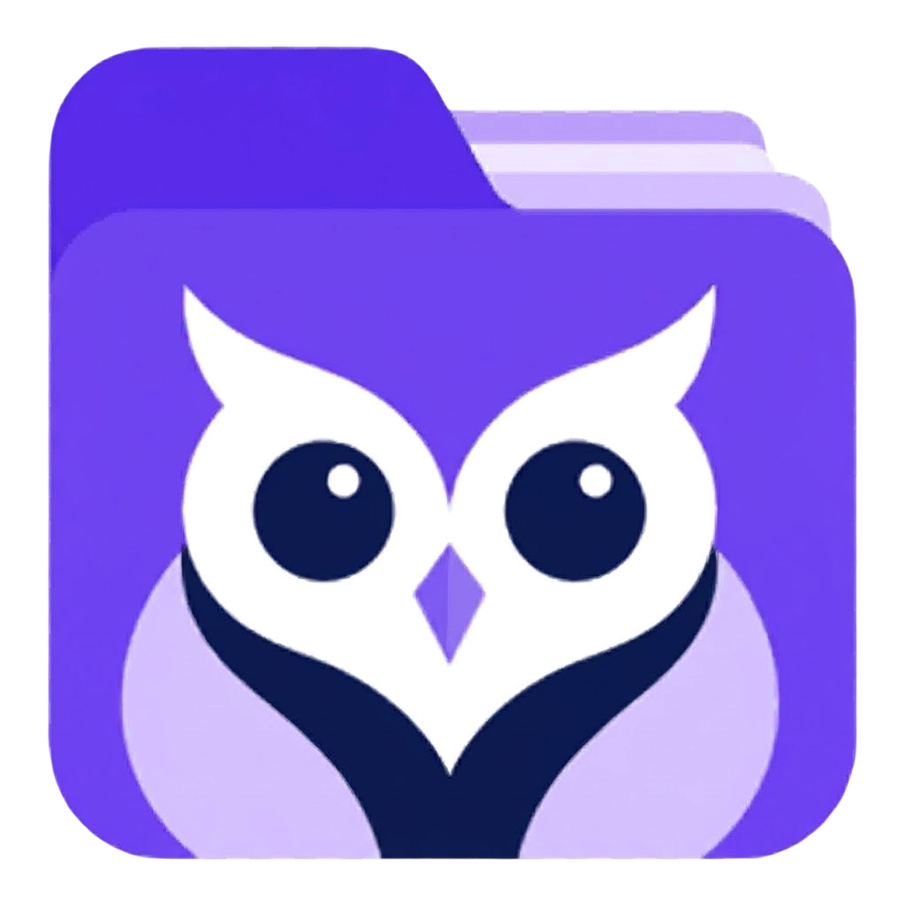

# OwlSift

<p align="center"></p>

**Find local documents, organize your files, and work with AI in one desktop workspace.**

**English** · [Русский](README.ru.md)

[Downloads](https://github.com/Nero656/OwlSift/releases) · [Report an issue](https://github.com/Nero656/OwlSift/issues) · [Support development](https://donate.trybit.com/AIE59TOI)

OwlSift combines document search, workspace folders, notes, and AI conversations. Connect Ollama or LM Studio for local inference, or configure a cloud provider. Use selected files as context, create documents, review proposed edits, and generate images through ComfyUI.

The desktop app uses Electron and a local SQLite index. Browser mode is also available, with different filesystem and storage capabilities.

## Contents

- [Features](#features)
- [Installation](#installation)
- [Getting started](#getting-started)
- [Search and scanning](#search-and-scanning)
- [Workspace folders](#workspace-folders)
- [AI setup](#ai-setup)
- [Image generation](#image-generation)
- [Storage and privacy](#storage-and-privacy)
- [Desktop vs browser](#desktop-vs-browser)
- [Development](#development)
- [Building installers](#building-installers)
- [Troubleshooting](#troubleshooting)
- [Contributing, support, and license](#contributing-support-and-license)

## Features

| Area | Capabilities |
| --- | --- |
| Document search | Find indexed files by name and available text content; filter by type; switch between list and grid views. |
| Disk scanning | Choose a drive and extensions, scan selected folders, stop scanning, and resume unfinished work. |
| Workspaces | Register existing folders or create real folders, including on the Desktop; import multiple files and copy/move them between workspaces. |
| File organization | Preview supported documents and images, open external applications, add notes and tags, sort results, and use pagination. |
| AI assistant | Chat with selected documents, ask for summaries and explanations, create files, and review edits before applying them. |
| Providers | Ollama, LM Studio, OpenAI, Gemini, and DeepSeek, with configurable endpoints and models. |
| Images | ComfyUI / Comfy Desktop integration with built-in or imported API workflows and workspace saving. |
| Interface | Light/dark themes, appearance customization, compact sidebar, English and Russian. Additional languages have partial translations with English fallback. |

## Installation

Download an installer from [GitHub Releases](https://github.com/Nero656/OwlSift/releases). If no release is published yet, build from source below. GitHub's automatic **Source code** archives do not contain installers.

### Windows x64

1. Download the installer ZIP, for example `OwlSift-1.0.0-win-x64-setup.zip`.
2. Extract it and run `OwlSift-1.0.0-win-x64-setup.exe`.
3. Follow the installation wizard and launch OwlSift.

### Linux x64: Debian / Ubuntu

Download the `.deb` package and run this from its directory:

```bash
sudo apt install ./OwlSift-1.0.0-linux-x64.deb
```

Launch OwlSift from the application menu. DEB packages are intended for Debian/Ubuntu-based distributions.

### Linux x64: AppImage

```bash
chmod +x OwlSift-1.0.0-linux-x64.AppImage
./OwlSift-1.0.0-linux-x64.AppImage
```

AppImage runs without a traditional installation. Some distributions require additional FUSE support.

Use the actual downloaded filename if it differs from these examples. Packaged desktop builds do not require Node.js or Docker. AI runtimes, model weights, and ComfyUI must be installed separately. Local AI hardware requirements depend on your selected models; models are not bundled with OwlSift.

If a `.sha256` file is supplied, compare it with `Get-FileHash <file> -Algorithm SHA256` in PowerShell or `sha256sum <file>` on Linux.

## Getting started

1. Choose your language and appearance in **Settings**.
2. Add an existing folder for indexing, or create a folder on the **Workspaces** page.
3. In **Documents**, choose a drive or folders and the desired extensions, then start scanning. Scanning does not start automatically.
4. Search, preview files, and add notes or tags.
5. For AI features, configure a provider in Settings, check the connection, and select an available model.
6. Open **AI Assistant**, attach relevant documents, and ask a question. Choose an output workspace when creating documents or images.

Search and file organization can be used without an AI provider.

## Search and scanning

Desktop search uses SQLite with FTS5. It searches the data actually indexed; it is not general semantic/vector search across every file on the computer.

- Choose a drive and file extensions.
- Scan the available drive scope or select multiple folders to scan in parts.
- Use **Stop** to interrupt the scan while preserving completed batches.
- Resume unfinished work from the saved checkpoint, including after reopening the app.
- Drive scanning skips hidden/system folders and common OS/dependency directories.

The scanner processes metadata first, then text content. Sequential reads, bounded database transactions, and saved queues reduce random HDD work and avoid rereading completed content batches on resume. Large drives can still take time.

### Formats and limits

| Operation | Current support |
| --- | --- |
| Drive scan filters | PDF, DOC, DOCX, ODT, RTF, TXT, MD, MARKDOWN, LOG, CSV, TSV, XLS, XLSX, ODS, PPT, PPTX, ODP, HTML, HTM, JSON, XML, YAML, YML. |
| Background content indexing | Supported plain-text/source-code formats are read as UTF-8 up to 2 MiB per file. Other formats may be searchable by name without indexed body text. |
| PDF / DOCX / ODT reading | Preview and AI context can extract text on demand. PDF extraction reads up to 100 pages; extracted text is capped at 120,000 characters. This is separate from background indexing. |
| File creation | PDF, DOCX, ODT, RTF, TXT, Markdown, CSV/TSV, JSON, HTML/CSS, and supported source-code/configuration formats. |

Selecting a scan extension does not guarantee text extraction or preview support. Scanned/image-only PDFs require OCR, which is not included. General extraction of legacy Office, spreadsheet, and presentation bodies is not implemented. AI context is bounded and may truncate large or multiple documents.

Folder imports default to 1,000 files, with interface choices from 100 to 5,000. Import limits are separate from the drive-scan queue.

## Workspace folders

Desktop workspaces reference actual filesystem folders.

- Create folders at the default Desktop location or choose another parent directory.
- Register an existing folder without relocating its files.
- Import multiple external files: they are copied into the workspace and originals stay in place.
- Copy or move a single file or a selection using menus and selection controls.
- Drag files between workspaces: internal dragging defaults to moving; Ctrl/Meta selects copying.
- Name collisions receive numbered filenames instead of overwriting existing destinations.
- Copies carry notes and tags; moves retain the indexed file's identity and update its path.

Removing a file from OwlSift and deleting it from disk are separate actions. Check the action label. AI edits reconstruct supported document formats from proposed text; complex formatting, embedded objects, and original layout may not survive. Review changes and back up important originals.

## AI setup

### Ollama

1. Install [Ollama](https://ollama.com/download) and download a text model suitable for your hardware.
2. Start Ollama and verify available models with `ollama list`.
3. In OwlSift Settings, choose the local provider, enable it, and select **Ollama**.
4. Enter `http://localhost:11434`. **Use the base URL without `/v1` for Ollama**, as model discovery uses `/api/tags`.
5. Check the connection and select a returned model.

### LM Studio

1. Install [LM Studio](https://lmstudio.ai/), download and load a model.
2. Start its API server from the **Developer** tab.
3. Select **LM Studio** in OwlSift and enter `http://127.0.0.1:1234/v1`, or your server's actual address and port.
4. Check the connection and select the model.

See the [LM Studio server documentation](https://lmstudio.ai/docs/developer/core/server).

### Cloud providers

Select **OpenAI**, **Gemini**, or **DeepSeek**, enter an API key, check the endpoint, and choose an available model. API access and billing are separate from OwlSift. Cloud requests send your prompt, relevant chat history, and supplied document context to the provider.

### Docker / WSL

`localhost` refers to the environment making the request. A Nuxt server inside Docker cannot reach a host model through its own `127.0.0.1`.

With Docker Desktop, a host Ollama server is commonly reachable at:

```text
http://host.docker.internal:11434
```

Configure Ollama to listen on an interface reachable from the container: set `OLLAMA_HOST=0.0.0.0:11434` in its launch environment and restart it. Limit access to your trusted private network with the firewall. See the [official Ollama environment/network instructions](https://docs.ollama.com/faq).

Native Linux Docker may need a `host-gateway` mapping for `host.docker.internal`; WSL may need a reachable host IP. Direct browser access can also require CORS configuration. Local-model requests can fall back to the Nuxt API proxy when available; static web deployments do not include that proxy.

## Image generation

ComfyUI / Comfy Desktop runs separately from OwlSift.

1. Run a working text-to-image workflow directly in ComfyUI first.
2. Enable **Comfy Desktop** in OwlSift Settings and enter the actual server base URL, commonly `http://localhost:8188`, without `/v1`.
3. Check the connection.
4. For the built-in workflow, choose a compatible full SD 1.x/SDXL checkpoint. Other architectures and custom graphs require an imported **API-format** workflow with prompt-node mappings.
5. Open image generation in AI Assistant, choose a workspace, enter a prompt, and generate.

Up to eight output images are saved per request, limited to 30 MB each. Optional prompt refinement uses the selected text provider independently of the image provider. Local-only workflow checks are enabled by default, but do not audit custom nodes or isolate their network activity. Stopping the wait in OwlSift does not guarantee interruption of a workflow already running in ComfyUI.

See the [ComfyUI integration guide](docs/comfy-integration.md) for workflow mapping, cloud nodes, transport modes, and cancellation behavior.

## Storage and privacy

- Desktop indexes, file paths, indexed text, notes, and tags are stored in local SQLite.
- Packaged apps keep the legacy **LocalMind** profile for compatibility: typically `%APPDATA%\LocalMind` on Windows and `~/.config/LocalMind` on Linux, unless platform configuration or launch arguments override it. The database is `localmind.db` inside that profile.
- Chats, settings, endpoints, and API keys use the app's local browser storage. The current implementation does not place API keys in an operating-system credential vault.
- Original files remain in their folders unless you explicitly import a copy, move, edit, or delete them.
- Local search does not require a cloud model. For local model processing, use locally hosted models and local ComfyUI workflows. Remote endpoints, cloud providers, prompt refinement, and cloud workflow nodes can send data outside your machine.
- Browser project bytes use IndexedDB; metadata/settings use local storage. Clearing site data can delete project copies.

Back up workspace files separately from the app profile. Close OwlSift before copying its profile for a consistent database backup. Settings backups may contain API keys.

## Desktop vs browser

| Capability | Desktop (Electron) | Browser |
| --- | --- | --- |
| Files | Real files and registered folders | Selected uploads/folders and project copies |
| Search storage | SQLite / FTS5 | Browser-stored project data |
| Drive scanning | Available within OS permissions | Select a folder; whole-drive scanning unavailable |
| Native folder creation and transfers | Available | Virtual folders; native transfers are desktop-only |
| Generated files | Written into the selected workspace | Project copies, downloadable through file links |
| Comfy transport | Electron main-process bridge | Nuxt proxy or Direct mode with appropriate CORS |

A browser connected to Docker imports files selected through the browser. Electron in a container sees only mounted paths; it cannot automatically scan every drive on the host.

## Development

### Stack and requirements

Nuxt 4, Vue 3, Nuxt UI 4, Tailwind CSS 4, TypeScript, Electron 38, and `better-sqlite3`. Supported document operations use `pdfjs-dist`, `pdf-lib`, and `fflate`.

Use Node.js 22 with current patch updates, npm, and Git. Native dependencies may need Python and C/C++ build tools if a suitable prebuilt binary is unavailable.

### Local development

```bash
git clone https://github.com/Nero656/OwlSift.git
cd OwlSift
npm ci
npm run dev
```

Open `http://localhost:3000` for browser mode. For the desktop window, run in a second terminal:

```bash
npm run electron:dev
```

Keep the Nuxt server running during Electron development.

### Docker development

```bash
docker compose up -d nuxt
```

Browser mode is available at `http://localhost:3000`. The Compose setup also includes Electron:

```bash
docker compose up --build electron
```

The Electron service requires a working X11 display and access to its display socket. Configure display access and filesystem mounts for your environment. This is a development setup; native packages are simpler for everyday use.

### Tests

```bash
npm run test:workspace
npm run test:scan
```

These compile Electron TypeScript and run file-operation and resumable-scan tests. They are not a complete renderer typecheck or end-to-end suite.

### Project layout

```text
app/             Vue pages, components, composables, document utilities
src/             Electron main/preload, SQLite, filesystem services
server/api/      Nuxt proxies for AI and ComfyUI
docs/            Integration guides
scripts/         Build, dependency, static asset, and database preparation
tests/           File-operation and scanning tests
assets/icons/    Desktop icons
public/          Static files and browser icons
release/         Generated installers/archives, ignored by Git
```

## Building installers

Build on the target OS with matching dependencies. Cross-platform packaging needs extra tooling; do not copy OS-specific native dependencies between Windows and Linux.

Prepare assets **in this order**:

```bash
npm run generate
npm run build:electron
```

These generate `.output/public`, compile `electron-build`, and prepare a clean release database without the developer's index.

Windows x64 NSIS installer:

```bash
npx electron-builder --win nsis --x64 --publish never
```

Wrap the installer in a ZIP using PowerShell:

```powershell
Compress-Archive -Path release/OwlSift-1.0.0-win-x64-setup.exe -DestinationPath release/OwlSift-1.0.0-win-x64-setup.zip
```

Linux x64 DEB and AppImage:

```bash
npx electron-builder --linux deb AppImage --x64 --publish never --config.linux.maintainer=Nero656
```

Use your own maintainer identity for a fork. Outputs go into `release/`; default Linux filenames may differ from uploaded asset names.

`npm run electron:build` runs frontend generation, Electron compilation, and configured platform packaging. `npm run electron:build:zip -- --win` (or `--linux`) creates a ZIP of the packaged application, **not a ZIP containing an installer**.

## Troubleshooting

| Problem | Check |
| --- | --- |
| No files appear | Start scanning/import manually; check scope, extensions, import limit, visibility, and filesystem permissions. |
| Name search works but content search does not | The format may lack background extraction or exceed the size limit. Try a supported preview or attach the document to chat. |
| PDF has no readable text | It may be scanned, empty, protected, or damaged. Built-in OCR is unavailable. |
| Model connection fails | Check runtime, model availability, provider-specific URL, CORS, firewall, and container networking. |
| Cloud API returns 401 / 429 | Check API key, provider account, billing, and request limits. |
| Comfy connects but generation fails | Test the graph in ComfyUI; check nodes, checkpoints, API export, prompt mappings, and local-only settings. |
| AppImage reports a FUSE error | Install the appropriate FUSE compatibility package or use DEB on a compatible distribution. |

## Contributing, support, and license

[Open an issue](https://github.com/Nero656/OwlSift/issues) with your OS, app version, reproduction steps, and sanitized logs. Remove API keys, private document contents, and personal paths before sharing logs/screenshots.

Pull requests are welcome. Include relevant tests and expected behavior for scanning, indexing, and filesystem changes.

You can [support development through Trybit](https://donate.trybit.com/AIE59TOI). The app also has a **Support the developer** dialog.

OwlSift uses the [MIT License](LICENSE). Third-party libraries, AI models, and ComfyUI nodes have their own licenses and terms.
