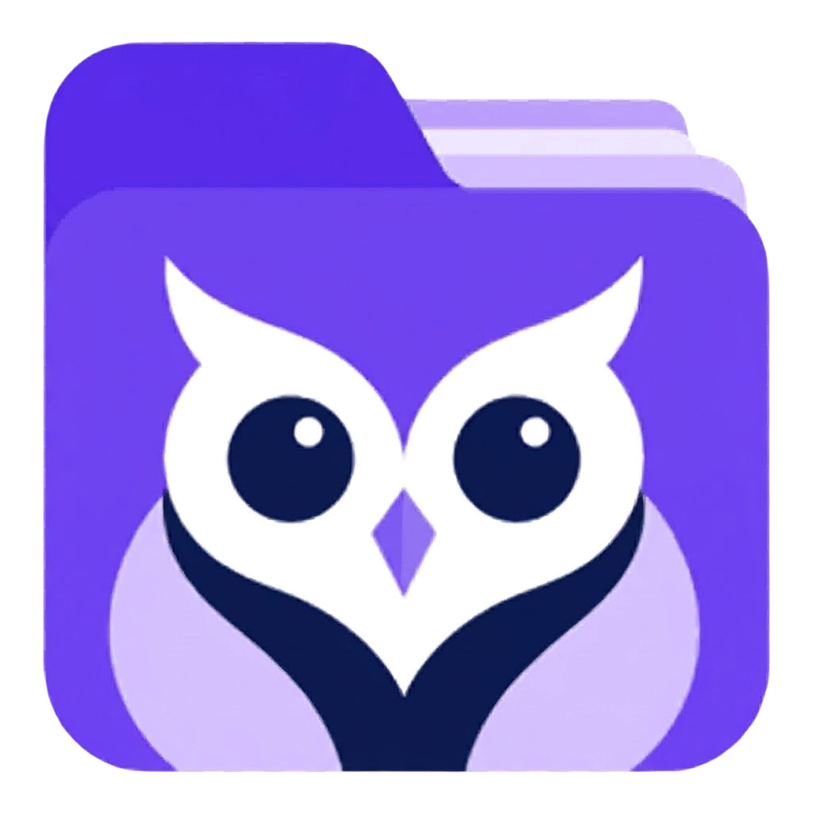

# OwlSift

<p align="center"></p>

**Поиск локальных документов, организация файлов и работа с ИИ в одном десктопном приложении.**

[English](README.md) · **Русский**

[Скачать](https://github.com/Nero656/OwlSift/releases) · [Сообщить об ошибке](https://github.com/Nero656/OwlSift/issues) · [Поддержать разработку](https://donate.trybit.com/AIE59TOI)

OwlSift объединяет поиск документов, рабочие папки, заметки и диалоги с ИИ. Подключите Ollama или LM Studio для локальной обработки либо настройте облачного провайдера. Используйте выбранные файлы как контекст, создавайте документы, проверяйте предложенные правки и генерируйте изображения через ComfyUI.

Десктопная версия использует Electron и локальный индекс SQLite. Также доступен браузерный режим, который отличается доступом к файловой системе и способом хранения данных.

## Содержание

- [Возможности](#возможности)
- [Установка](#установка)
- [Первый запуск](#первый-запуск)
- [Поиск и сканирование](#поиск-и-сканирование)
- [Рабочие папки](#рабочие-папки)
- [Подключение ИИ](#подключение-ии)
- [Генерация изображений](#генерация-изображений)
- [Хранение данных и приватность](#хранение-данных-и-приватность)
- [Десктоп и браузер](#десктоп-и-браузер)
- [Разработка](#разработка)
- [Сборка установщиков](#сборка-установщиков)
- [Решение проблем](#решение-проблем)
- [Участие, поддержка и лицензия](#участие-поддержка-и-лицензия)

## Возможности

| Раздел | Что можно делать |
| --- | --- |
| Поиск документов | Искать проиндексированные файлы по имени и доступному текстовому содержимому, фильтровать по типу, переключать список и сетку. |
| Сканирование диска | Выбирать диск и расширения, сканировать отдельные папки, останавливать процесс и продолжать незавершённую работу. |
| Рабочие папки | Подключать существующие или создавать настоящие папки, в том числе на рабочем столе; добавлять несколько файлов, копировать и переносить их между папками. |
| Организация файлов | Просматривать поддерживаемые документы и изображения, открывать внешние приложения, добавлять заметки и теги, сортировать результаты и использовать постраничный вывод. |
| ИИ-ассистент | Обсуждать выбранные документы, получать краткие описания и объяснения, создавать файлы и проверять правки перед применением. |
| Провайдеры | Ollama, LM Studio, OpenAI, Gemini и DeepSeek с настройкой адреса и модели. |
| Изображения | Интеграция ComfyUI / Comfy Desktop, встроенные и импортированные API workflow, сохранение в рабочую папку. |
| Интерфейс | Светлая и тёмная темы, настройка оформления, компактная боковая панель, английский и русский языки. Дополнительные языки переведены частично с подстановкой английского текста. |

## Установка

Выберите установщик на странице [GitHub Releases](https://github.com/Nero656/OwlSift/releases). Если релиз пока не опубликован, воспользуйтесь инструкцией сборки ниже. Автоматические архивы GitHub **Source code** содержат исходники, а не установщики.

### Windows x64

1. Скачайте ZIP с установщиком, например `OwlSift-1.0.0-win-x64-setup.zip`.
2. Распакуйте архив и запустите `OwlSift-1.0.0-win-x64-setup.exe`.
3. Выполните шаги мастера установки и откройте OwlSift.

### Linux x64: Debian / Ubuntu

Скачайте пакет `.deb` и выполните команду из его каталога:

```bash
sudo apt install ./OwlSift-1.0.0-linux-x64.deb
```

Запустите OwlSift из меню приложений. Пакет предназначен для дистрибутивов на базе Debian/Ubuntu.

### Linux x64: AppImage

```bash
chmod +x OwlSift-1.0.0-linux-x64.AppImage
./OwlSift-1.0.0-linux-x64.AppImage
```

AppImage запускается без обычной установки. В некоторых дистрибутивах нужна дополнительная поддержка FUSE.

Если имя скачанного файла отличается, указывайте фактическое имя. Для готового десктопного приложения не нужны Node.js и Docker. Среда запуска ИИ, веса моделей и ComfyUI устанавливаются отдельно. Требования локального ИИ к памяти и видеокарте зависят от выбранных моделей; в установщик OwlSift модели не входят.

При наличии файла `.sha256` сравните сумму с результатом `Get-FileHash <файл> -Algorithm SHA256` в PowerShell или `sha256sum <файл>` в Linux.

## Первый запуск

1. Выберите язык и оформление в **Настройках**.
2. Добавьте существующую папку для индексации или создайте новую на странице **Рабочие папки**.
3. В разделе **Документы** выберите диск или папки, нужные расширения и запустите сканирование. Автоматически оно не начинается.
4. Найдите файл, откройте предпросмотр, добавьте заметку или теги.
5. Для работы с ИИ настройте провайдера, проверьте подключение и выберите доступную модель.
6. Откройте **ИИ-ассистента**, прикрепите документы и задайте вопрос. Для создания документов и изображений выберите папку сохранения.

Поиск и организация файлов доступны без подключения ИИ.

## Поиск и сканирование

Десктопный поиск использует SQLite и FTS5. Он работает с реально проиндексированными данными; это не универсальный семантический или векторный поиск по всем файлам компьютера.

- Выберите диск и расширения файлов.
- Сканируйте доступную область диска либо укажите несколько папок для сканирования частями.
- Нажмите **Стоп**, чтобы прервать процесс с сохранением завершённых пакетов.
- Продолжите работу с сохранённой контрольной точки, в том числе после повторного открытия приложения.
- При сканировании диска пропускаются скрытые и системные папки, а также распространённые каталоги ОС и зависимостей.

Сначала собираются метаданные, затем читается текст. Последовательное чтение, пакетные записи в базу и сохранённые очереди сокращают случайные обращения к HDD и позволяют не перечитывать завершённые пакеты содержимого. На больших дисках процесс всё равно может занять значительное время.

### Форматы и ограничения

| Операция | Текущая поддержка |
| --- | --- |
| Фильтры сканирования диска | PDF, DOC, DOCX, ODT, RTF, TXT, MD, MARKDOWN, LOG, CSV, TSV, XLS, XLSX, ODS, PPT, PPTX, ODP, HTML, HTM, JSON, XML, YAML, YML. |
| Фоновая индексация содержимого | Поддерживаемые текстовые файлы и исходники читаются как UTF-8, если размер не превышает 2 МиБ. Другие форматы могут находиться по имени без проиндексированного текста. |
| Чтение PDF / DOCX / ODT | Для предпросмотра и контекста ИИ текст извлекается по запросу. Для PDF читается до 100 страниц; объём извлечённого текста ограничен 120 000 символов. Это отдельный механизм, не фоновая индексация. |
| Создание файлов | PDF, DOCX, ODT, RTF, TXT, Markdown, CSV/TSV, JSON, HTML/CSS и поддерживаемые форматы исходного кода и конфигураций. |

Выбор расширения не гарантирует извлечение текста или предпросмотр. Для PDF со сканами и документов из изображений требуется OCR, которого в этой версии нет. Универсальное извлечение содержимого старых Office-файлов, таблиц и презентаций не реализовано. Контекст ИИ ограничен: большие документы и наборы файлов могут передаваться частично.

Для импорта папок по умолчанию действует лимит 1 000 файлов, в интерфейсе доступны значения от 100 до 5 000. Ограничения импорта отделены от очереди сканирования диска.

## Рабочие папки

В десктопной версии рабочие папки соответствуют настоящим папкам файловой системы.

- Создавайте папки на рабочем столе по умолчанию или выбирайте другое расположение.
- Подключайте существующую папку без перемещения файлов.
- Импортируйте несколько внешних файлов: они копируются в рабочую папку, оригиналы остаются на месте.
- Копируйте и переносите один файл или выделенную группу через меню и кнопки групповых операций.
- Перетаскивайте файлы между папками: по умолчанию выполняется перенос, с Ctrl/Meta — копирование.
- При совпадении имён создаётся имя с номером, существующий файл назначения не перезаписывается.
- При копировании сохраняются заметки и теги; при переносе сохраняется идентификатор в индексе и обновляется путь.

Убрать файл из OwlSift и удалить его с диска — разные действия. Проверяйте подпись команды. Правки через ИИ пересоздают поддерживаемые форматы из нового текста: сложное оформление, встроенные объекты и исходная вёрстка могут не сохраниться. Проверяйте изменения и сохраняйте резервные копии важных оригиналов.

## Подключение ИИ

### Ollama

1. Установите [Ollama](https://ollama.com/download) и загрузите текстовую модель, подходящую вашему компьютеру.
2. Запустите Ollama и проверьте доступные модели командой `ollama list`.
3. В настройках OwlSift выберите локального провайдера, включите интеграцию и укажите **Ollama**.
4. Введите `http://localhost:11434`. **Для Ollama нужен базовый адрес без `/v1`**, поскольку список моделей запрашивается через `/api/tags`.
5. Проверьте подключение и выберите модель из списка.

### LM Studio

1. Установите [LM Studio](https://lmstudio.ai/), скачайте и загрузите модель.
2. Запустите API-сервер на вкладке **Developer**.
3. Выберите **LM Studio** в OwlSift и укажите `http://127.0.0.1:1234/v1` либо фактический адрес и порт сервера.
4. Проверьте подключение и выберите модель.

Подробнее — в [документации сервера LM Studio](https://lmstudio.ai/docs/developer/core/server).

### Облачные провайдеры

Выберите **OpenAI**, **Gemini** или **DeepSeek**, введите API-ключ, проверьте адрес и выберите доступную модель. Доступ к API и оплата запросов оформляются отдельно у провайдера. При облачном запросе провайдеру передаются промпт, соответствующая история диалога и добавленный контекст документов.

### Docker / WSL

`localhost` указывает на среду, из которой отправляется запрос. Nuxt-сервер внутри Docker не может обратиться к модели на хосте через собственный `127.0.0.1`.

При использовании Docker Desktop Ollama на хосте обычно доступна по адресу:

```text
http://host.docker.internal:11434
```

Ollama должна слушать интерфейс, доступный контейнеру: установите `OLLAMA_HOST=0.0.0.0:11434` в окружении её запуска и перезапустите. Ограничьте доступ доверенной частной сетью через брандмауэр. Настройка переменных и сети описана в [официальной справке Ollama](https://docs.ollama.com/faq).

В обычном Docker под Linux для `host.docker.internal` может потребоваться сопоставление `host-gateway`; в WSL — доступный из её сети IP хоста. Прямой доступ из браузера также может требовать настройки CORS. Для локальных моделей предусмотрен запрос через API-прокси Nuxt при его доступности; в статической веб-сборке такого прокси нет.

## Генерация изображений

ComfyUI / Comfy Desktop запускается отдельно от OwlSift.

1. Сначала запустите рабочий text-to-image workflow непосредственно в ComfyUI.
2. Включите **Comfy Desktop** в настройках OwlSift и введите фактический базовый адрес сервера, обычно `http://localhost:8188`, без `/v1`.
3. Проверьте подключение.
4. Для встроенного workflow выберите совместимый полный checkpoint SD 1.x/SDXL. Для других архитектур и собственных графов импортируйте workflow в **API-формате** и настройте узлы ввода промпта.
5. Откройте генерацию в ИИ-ассистенте, выберите рабочую папку, введите запрос и запустите генерацию.

За один запрос сохраняется до восьми изображений размером до 30 МБ каждое. Необязательное улучшение промпта использует выбранного текстового провайдера независимо от модели изображений. Проверки local-only включены по умолчанию, но не проводят аудит пользовательских узлов и не изолируют их сетевую активность. Прекращение ожидания в OwlSift не гарантирует остановку workflow, уже выполняющегося в ComfyUI.

В [руководстве по ComfyUI](docs/comfy-integration.md) на английском описаны сопоставления workflow, облачные узлы, режимы подключения и поведение при отмене.

## Хранение данных и приватность

- Индекс десктопной версии, пути, проиндексированный текст, заметки и теги хранятся локально в SQLite.
- Для совместимости готовые сборки используют прежний профиль **LocalMind**: обычно `%APPDATA%\LocalMind` в Windows и `~/.config/LocalMind` в Linux, если расположение не изменено конфигурацией платформы или параметрами запуска. Внутри находится база `localmind.db`.
- Диалоги, настройки, адреса и API-ключи используют локальное браузерное хранилище приложения. Текущая реализация не помещает API-ключи в системное хранилище учётных данных.
- Исходные файлы остаются в своих папках, пока вы явно не импортируете копию, не перенесёте, не измените или не удалите их.
- Локальный поиск не требует облачной модели. Для локальной обработки используйте модели на своём компьютере и локальные workflow ComfyUI. Удалённые адреса, облачные провайдеры, улучшение промпта и облачные узлы могут передавать данные за пределы компьютера.
- В браузере байты файлов хранятся в IndexedDB, а метаданные и настройки — в local storage. Очистка данных сайта может удалить копии проектов.

Сохраняйте резервные копии рабочих файлов отдельно от профиля. Перед копированием профиля закройте OwlSift, чтобы получить согласованную копию базы. Резервная копия настроек может содержать API-ключи.

## Десктоп и браузер

| Возможность | Десктоп (Electron) | Браузер |
| --- | --- | --- |
| Файлы | Настоящие файлы и подключённые папки | Выбранные файлы/папки и копии проектов |
| Хранилище поиска | SQLite / FTS5 | Данные проектов в браузере |
| Сканирование диска | В пределах прав ОС | Выбор папки; сканирование всего диска недоступно |
| Настоящие папки и перенос файлов | Доступны | Виртуальные папки; операции переноса по файловой системе доступны только в десктопе |
| Созданные файлы | Запись в выбранную рабочую папку | Копии проекта, скачивание по ссылкам |
| Подключение ComfyUI | Через основной процесс Electron | Прокси Nuxt или Direct с подходящими настройками CORS |

Браузер, подключённый к Docker, импортирует файлы, выбранные через браузер. Electron внутри контейнера видит только смонтированные пути и не получает автоматический доступ ко всем дискам хоста.

## Разработка

### Технологии и требования

Nuxt 4, Vue 3, Nuxt UI 4, Tailwind CSS 4, TypeScript, Electron 38 и `better-sqlite3`. Для операций с документами используются `pdfjs-dist`, `pdf-lib` и `fflate`.

Нужны Node.js 22 с актуальными исправлениями, npm и Git. Если для нативной зависимости нет подходящего готового бинарника, могут понадобиться Python и инструменты сборки C/C++.

### Локальная разработка

```bash
git clone https://github.com/Nero656/OwlSift.git
cd OwlSift
npm ci
npm run dev
```

Откройте `http://localhost:3000` для браузерного режима. Для десктопного окна выполните во втором терминале:

```bash
npm run electron:dev
```

Во время разработки в Electron сервер Nuxt должен оставаться запущенным.

### Разработка через Docker

```bash
docker compose up -d nuxt
```

Браузерная версия доступна по адресу `http://localhost:3000`. В Compose также настроен Electron:

```bash
docker compose up --build electron
```

Для сервиса Electron нужны работающий X11-дисплей и доступ к его сокету. Настройте дисплей и подключаемые каталоги для своей среды. Это конфигурация разработки; для обычной работы проще использовать готовый пакет.

### Тесты

```bash
npm run test:workspace
npm run test:scan
```

Команды компилируют TypeScript Electron и проверяют файловые операции и возобновляемое сканирование. Они не заменяют полную проверку типов интерфейса и сквозные тесты приложения.

### Структура проекта

```text
app/             Страницы Vue, компоненты, composables, утилиты документов
src/             Electron main/preload, SQLite, файловые сервисы
server/api/      Прокси Nuxt для ИИ и ComfyUI
docs/            Руководства по интеграциям
scripts/         Подготовка сборки, зависимостей, статики и базы данных
tests/           Тесты файловых операций и сканирования
assets/icons/    Иконки десктопного приложения
public/          Статические файлы и иконки браузера
release/         Установщики и архивы, исключены из Git
```

## Сборка установщиков

Собирайте на целевой ОС с подходящими зависимостями. Кроссплатформенная упаковка требует дополнительных инструментов; нативные зависимости Windows и Linux нельзя просто переносить между системами.

Подготовьте ресурсы **в указанном порядке**:

```bash
npm run generate
npm run build:electron
```

Команды создают `.output/public`, компилируют `electron-build` и готовят чистую базу релиза без индекса разработчика.

Установщик NSIS для Windows x64:

```bash
npx electron-builder --win nsis --x64 --publish never
```

Чтобы поместить установщик в ZIP, выполните в PowerShell:

```powershell
Compress-Archive -Path release/OwlSift-1.0.0-win-x64-setup.exe -DestinationPath release/OwlSift-1.0.0-win-x64-setup.zip
```

DEB и AppImage для Linux x64:

```bash
npx electron-builder --linux deb AppImage --x64 --publish never --config.linux.maintainer=Nero656
```

Для форка укажите собственные данные сопровождающего. Файлы находятся в `release/`; стандартные имена Linux-файлов могут отличаться от названий опубликованных установщиков.

`npm run electron:build` выполняет генерацию фронтенда, компиляцию Electron и упаковку для настроенной платформы. `npm run electron:build:zip -- --win` (или `--linux`) создаёт ZIP с упакованным приложением, **а не ZIP с установщиком**.

## Решение проблем

| Проблема | Что проверить |
| --- | --- |
| Файлы не появляются | Запустите импорт/сканирование вручную; проверьте область, расширения, лимит импорта, видимость и права доступа. |
| Файл находится по имени, но не по содержимому | Для формата может отсутствовать фоновое извлечение текста или превышен лимит размера. Попробуйте поддерживаемый предпросмотр или прикрепите файл к диалогу. |
| В PDF нет читаемого текста | Возможны сканы, пустой, защищённый или повреждённый файл. Встроенного OCR нет. |
| Модель не подключается | Проверьте запуск среды, наличие модели, адрес для выбранного провайдера, CORS, брандмауэр и сеть контейнера. |
| Облачный API отвечает 401 / 429 | Проверьте API-ключ, аккаунт, оплату и ограничения запросов. |
| Comfy подключён, но генерация не идёт | Запустите граф в ComfyUI; проверьте узлы, checkpoint, API-формат, сопоставления промптов и режим local-only. |
| AppImage сообщает об ошибке FUSE | Установите пакет совместимости FUSE для дистрибутива либо используйте DEB на совместимой системе. |

## Участие, поддержка и лицензия

При [создании issue](https://github.com/Nero656/OwlSift/issues) укажите ОС, версию приложения, шаги воспроизведения и подходящие логи. Удалите API-ключи, конфиденциальное содержимое документов и личные пути перед публикацией логов и скриншотов.

Предложения и исправления принимаются через pull request. Для изменений сканирования, индексации и файловых операций добавляйте соответствующие тесты и описание ожидаемого поведения.

Можно [поддержать разработку через Trybit](https://donate.trybit.com/AIE59TOI). В приложении также есть окно **Поддержать разработчика**.

OwlSift распространяется по [лицензии MIT](LICENSE). Сторонние библиотеки, модели ИИ и узлы ComfyUI имеют собственные лицензии и условия.
